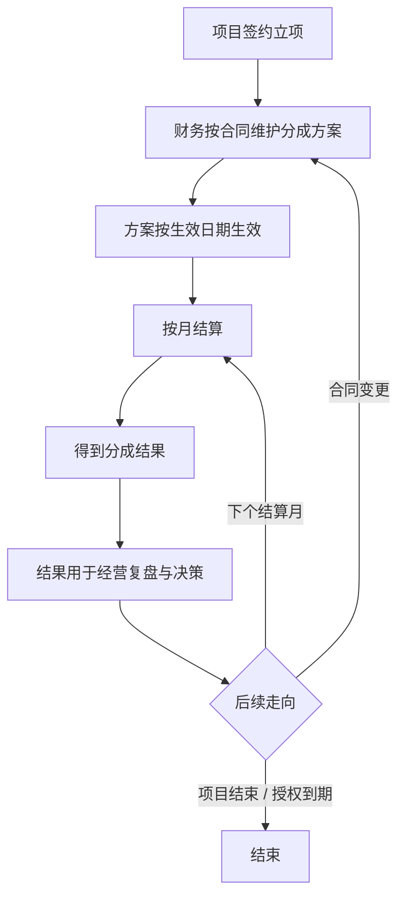
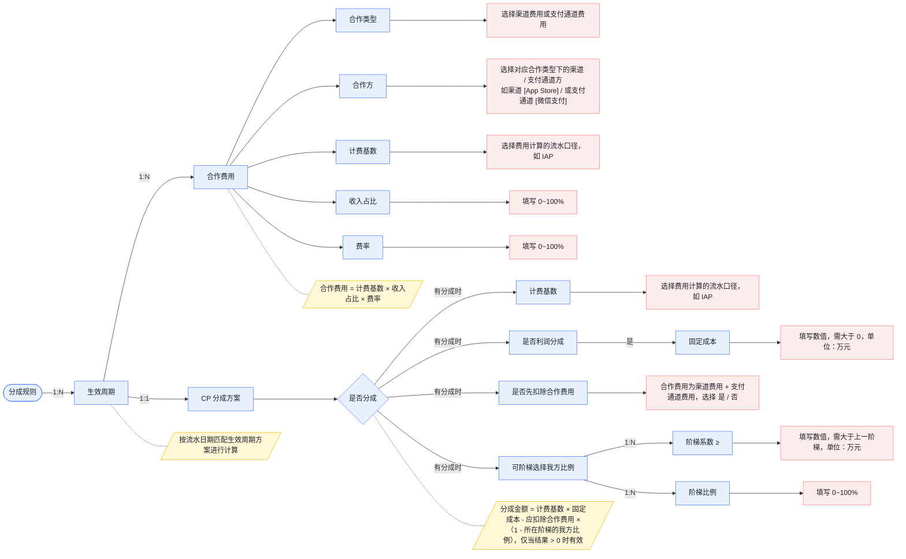
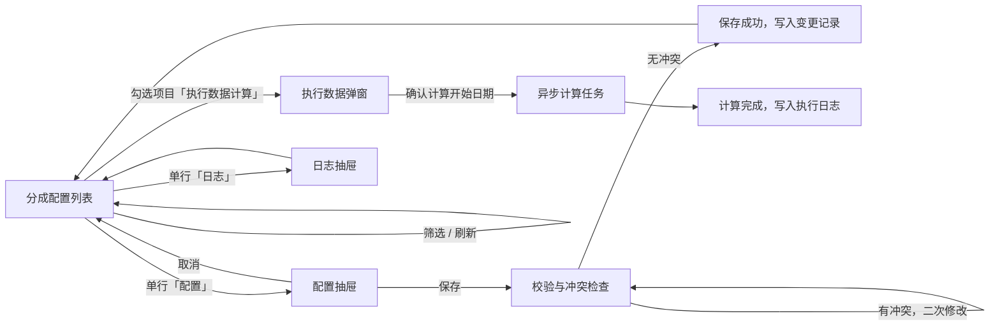

# PRD · 财务分成配置

## 报告头

| 项      | 说明                                                                                  |
| ------ | ----------------------------------------------------------------------------------- |
| 需求名    | 财务分成配置                                                                              |
| 承接调研报告 | [调研报告\_财务分成配置\_20261008.md](../../docs/requirements/财务分成配置/调研报告_财务分成配置_20261008.md) |
| 干系人    | 需求方：财务；PM：witt；后端技术                                                                 |
| 分支     | witt/finance-revenue-share                                                          |
| 配套产物   | <br />                                                                              |

## 一、需求背景与目标

### 1.1 背景

在游戏发行生态中，公司作为发行方，需要对一款游戏的收入流水与研发（CP 方）进行分成。

### 1.2 要解决的问题

公司未来与各CP方合作每款游戏时，会通过合同落实CP分成条款：

（1）需要支持财务将每个游戏的条款在系统去配置体现，即能覆盖到主流的合同条款规则

（2）需要将财务配置好的每个游戏的条款规则，用于BI看板、财务系统结算报表等相关产品的分成后指标计算，确保配置好的条款规则可以在公司内部业务层面体现

（3）需要考虑业务闭环运行中的各类边界场景问题，如：某款游戏的CP合同变更、财务操作错误等

### 1.3 目标与达成标准

支持CP分成的长期管理运行：

（1）上线后对于首批（以MVP阶段为准）合作发行的CP条款配置能覆盖，未来遇到其他类的条款能较好的拓展兼容

（2）支持财务日常维护新增/变更的CP条款的录入与更新，包括考虑到财务忘记录入、录入错误后修改等场景

（3）对于财务更新配置的条款规则，支持更新到各类产品的分成后指标运算中，做到常规不走开发手动执行

## 二、业务流程



## 三、整体方案思路

### 3.1 一句话方案

提供一套分成配置能力，支持配置「渠道费用 / 支付通道费用 / CP 分成」三类内容；财务新增或编辑配置后，计算结果回到 BI 看板。

### 3.2 核心设计

| # | 设计         | 说明                            | 为什么这么设计                                                |
| - | ---------- | ----------------------------- | ------------------------------------------------------ |
| 1 | 支持三类配置内容   | 渠道费用、支付通道费用、CP 分成             | 覆盖发行业务 CP 分成的各个合同条款诉求，基于常见条款来抽象规则。做到支持第一批              |
| 2 | 配置 → 计算的闭环 | 财务新增 / 编辑配置 → 一键执行计算结果回 BI 看板 | 配置得到的分成规则要被 BI 看板与财务结算报表引用计算，不能每次更新规则就找数据开发手动跑数，考虑场景闭环 |
| 3 | 兼容三类边界场景   | 财务人员忘记配置 / 配置错误后修改 / CP 合同变更  | 实际使用中这几件事会发生                                           |

**三类配置内容明细**

| #   | 配置内容       | 说明                                                                                                      |
| --- | ---------- | ------------------------------------------------------------------------------------------------------- |
| 1️⃣ | **渠道费用**   | 游戏发布到指定渠道时，渠道方收取的费用，一般是按照流水的比例收取                                                                        |
| 2️⃣ | **支付通道费用** | 用户在游戏充值时使用的付费通道，通道方收取的费用，一般是按照流水的比例收取                                                                   |
| 3️⃣ | **CP 分成**  | 发行与 CP 对流水收入的分成管理，一般有比例 / 阶梯比例等综合管理方式；且需要考虑分成时用的是什么**节点**（支付渠道 / 通道费用**前或后**等）与什么**口径**（IAA 与 IAP 等）的流水 |

### 3.3 范围

| 项     | 内容                           |
| ----- | ---------------------------- |
| 本期覆盖  | 分成方案配置 + BI 看板相关指标计算预留，做完整闭环 |
| 本期不覆盖 | 结算单生成、对账、开票环节等；权限等           |

## 四、方案内容

### 4.1 抽象规则设计



### 4.2 页面构成与功能流程

**页面构成**

| 页面 / 层 | 作用                                                           |
| ------ | ------------------------------------------------------------ |
| 分成配置列表 | 展示每个游戏项目的配置情况；提供刷新、筛选、批量执行计算，以及单行的「配置 / 日志」入口                |
| 配置抽屉   | 维护单个游戏项目的分成规则：**先选要维护的生效周期，再在该周期下**配置合作费用（可多条）与 CP 分成方案（仅一条） |
| 执行数据弹窗 | 对勾选的项目发起计算：确认涉及的项目与计算开始日期                                    |
| 日志抽屉   | 查看两类日志：规则变更记录 / 数据执行日志                                       |

**用户操作顺序**

进入配置抽屉后的操作顺序（与 4.1 抽象规则设计的结构一致）：

1. 选择或新增**生效周期**
2. 在当前生效周期下，配置**合作费用**（可多条：增加 / 删除 / 逐条配置）
3. 配置 **CP 分成方案**（仅一条）
4. 保存

**功能流程图**



### 4.3 功能树与功能点说明

**功能树**

```
分成配置
├── 分成配置列表
│   ├── 列表展示
│   ├── 筛选
│   ├── 刷新
│   ├── 勾选
│   ├── 批量操作（执行数据计算）
│   └── 单行操作（配置 / 日志）
├── 配置抽屉
│   ├── 生效周期（切换 / 新增 / 删除）
│   └── 当前生效周期的配置
│       ├── 合作费用（增加 / 删除 / 逐条配置）
│       └── CP 分成方案（仅一条）
├── 执行数据弹窗
│   ├── 涉及项目清单
│   ├── 计算开始日期
│   ├── 发起执行
│   └── 执行中与完成反馈
└── 日志抽屉
    ├── 规则变更记录
    └── 数据执行日志
```

**功能点说明**

| # | 功能点 | 所在位置 | 做什么 | 关键规则 |
| - | --- | --- | --- | --- |
| F1 | 列表展示 | 列表页 | 展示每个游戏项目及其配置情况 | 6 列：游戏项目 / 研发工作室 / 发布地区 / 发布端口 / 生效周期 / 今日状态 |
| F2 | 筛选 | 列表页 | 快速定位项目 | 搜索匹配项目名与游戏名；状态按「今日状态」过滤（全部 / 有效 / 未配置） |
| F3 | 刷新 | 列表页 | 重新拉取项目列表 | 只重新拉取游戏项目主数据（名称、研发工作室、地区、端口），不改动分成配置 |
| F4 | 勾选 | 列表页 | 选择要执行的项目 | 单个 / 多个 / 全选；顶部显示已选数量 |
| F5 | 批量「执行数据计算」 | 列表页 | 对勾选项目发起计算 | 未勾选时拦截并提示，不打开弹窗 |
| F6 | 单行「配置」 | 列表页 | 打开配置抽屉 | 未配置项目打开时给出提示，并**自动新增一个空的生效周期（起止留空待填）** |
| F7 | 单行「日志」 | 列表页 | 打开日志抽屉 | — |
| F8 | 生效周期管理 | 配置抽屉 | 切换 / 新增 / 删除生效周期 | 同一方案内各生效周期的时间区间不允许交集 |
| F9 | 生效周期区间 | 配置抽屉 | 设置当前生效周期的起止 | 均为必填，开始日期不得晚于结束日期 |
| F10 | 合作费用增删 | 配置抽屉 | 增加 / 删除费用行 | 可为空：0 条或多条皆可；每一条都可以删除 |
| F11 | 合作费用配置 | 配置抽屉 | 逐条配置一笔合作费用 | 按序选择：合作类型 → 合作方 → 计费基数 → 收入占比 → 费率 |
| F12 | CP 分成方案配置 | 配置抽屉 | 配置对 CP 的分成安排 | 仅一条；字段随「是否分成」「是否利润分成」变化 |
| F13 | 保存与校验 | 配置抽屉 | 保存配置 | 校验不通过则不允许保存；有冲突时二次修改后重新校验 |
| F14 | 执行数据弹窗 | 执行弹窗 | 确认涉及项目与计算开始日期 | 计算开始日期默认今天 |
| F15 | 发起执行与反馈 | 执行弹窗 | 发起异步计算任务并展示进度与结果 | 完成后写入数据执行日志 |
| F16 | 规则变更记录 | 日志抽屉 | 查看规则改动 | 字段：操作人、修改时间、修改内容、关联生效周期 |
| F17 | 数据执行日志 | 日志抽屉 | 查看计算记录 | 字段：操作人、发起时间、计算开始日期、涉及项目、执行结果 |  

## 五、前端页面产物说明与数据预留对接

### 5.1 页面产物说明

| 项      | 内容     |
| ------ | ------ |
| <br /> | <br /> |

### 5.2 数据预留对接

| #      | 页面位置   | 意图     | 想要的请求参 | 期望的返回参 |
| ------ | ------ | ------ | ------ | ------ |
| <br /> | <br /> | <br /> | <br /> | <br /> |

## 附录

### 附录 A 字段说明

| 字段     | 含义     | 取值     | 必填     | 默认值    | 来源     |
| ------ | ------ | ------ | ------ | ------ | ------ |
| <br /> | <br /> | <br /> | <br /> | <br /> | <br /> |

### 附录 B 待确认清单

| # | 待确认事项                     | 拍板人     |
| - | ------------------------- | ------- |
| 1 | PM 基于经验输出分成配置方案，然后由财务一起确认 | PM + 财务 |

### 附录 C 引用

| 引用                                                                                  | 说明               |
| ----------------------------------------------------------------------------------- | ---------------- |
| [调研报告\_财务分成配置\_20261008.md](../../docs/requirements/财务分成配置/调研报告_财务分成配置_20261008.md) | 本 PRD 一对一承接的调研报告 |
| <br />                                                                              | <br />           |

